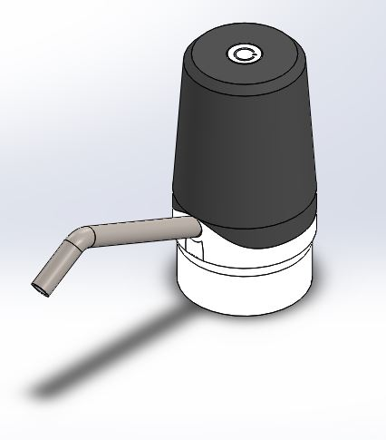
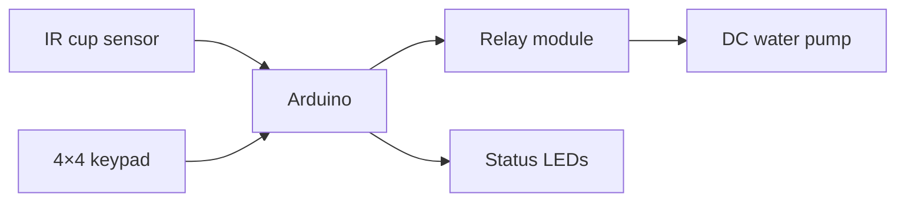
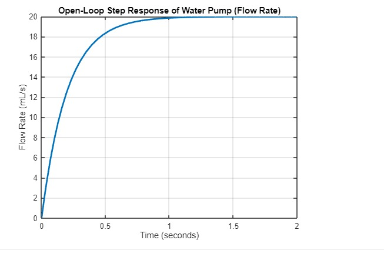
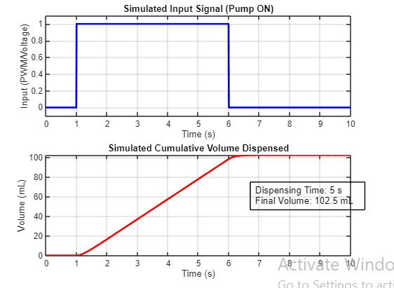

# Automatic Water Dispenser

An academic team prototype that combines Arduino firmware, a cup-detection safety interlock, keypad-selected dispensing, pump control, Proteus simulation, and a custom SolidWorks enclosure.



## What the system does

- Detects a cup with an IR proximity sensor
- Accepts a dispensing preset from a 4×4 keypad
- Drives a DC pump through a relay
- Shows cup-detected and pump-running states with LEDs
- Stops the pump after a configurable duration

The current implementation uses **open-loop timed dispensing**. The preset durations must be calibrated against the actual pump, supply voltage, reservoir level, and tubing before the displayed volumes can be treated as accurate.

## System architecture



## Repository contents

```text
assets/       CAD views and simulation plots
cad/          SolidWorks assembly and part files
firmware/     Arduino firmware
simulation/   Proteus project
```

## Firmware configuration

The main calibration values are in `firmware/automatic_water_dispenser.ino`:

```cpp
const unsigned long TIME_50  = 1500;
const unsigned long TIME_100 = 3000;
const unsigned long TIME_150 = 4500;
```

These names describe the intended presets, not guaranteed measured volumes. Recalibrate the durations after any hardware or fluid-path change.

## Modeling work

The pump was approximated with a first-order response during the academic design phase. The plots below show the modeled flow response and cumulative volume for a timed input.

| Pump response | Timed dispensing simulation |
| --- | --- |
|  |  |

## Hardware notes

- Keep water and exposed electronics physically separated.
- Confirm whether the relay and IR module are active-high or active-low before running the pump.
- Use a supply sized for the pump current. Do not power the pump directly from an Arduino pin.
- Add a flyback path where required by the selected relay or driver hardware.

## Project context

This was completed as a university team project. This portfolio repository focuses on the system architecture and the artifacts available in the submitted project folder; it does not assign unverified individual ownership of team work.

Academic portfolio material. No license is granted for reuse.

